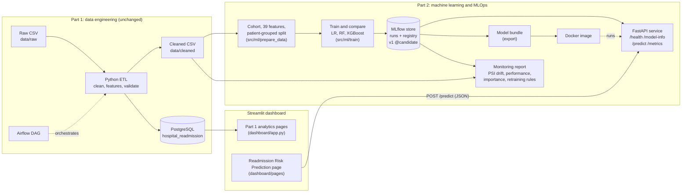

# Architecture: Part 1 and Part 2

Part 1 (data engineering) is unchanged. Part 2 reads Part 1's cleaned file
and adds the machine-learning workflow, the prediction service and the
dashboard page. GitHub renders the diagram below; the Part 1 diagram is
`docs/architecture.png`.

## Components

| Component | Code | Runs as | Documentation |
|---|---|---|---|
| Cohort, features, split | `src/ml/data.py`, `features.py`, `split.py`, `prepare_data.py` | `python -m src.ml.prepare_data` | `phase2_data_preparation.md` |
| Training and selection | `src/ml/train.py`, `metrics.py`, `selection.py` | `python -m src.ml.train` | `phase3_model_training.md` |
| Tracking and registry | `src/ml/tracking.py`, `log_phase3_to_mlflow.py`, `register_model.py` | MLflow, SQLite store `mlflow.db` | `phase4_mlflow_tracking.md` |
| Prediction API | `src/api/` | `uvicorn src.api.main:app` | `phase5_api.md` |
| Container | `Dockerfile`, `src/api/bundle.py` | `docker run` with the bundle mounted read-only | `phase6_docker.md` |
| Monitoring | `src/monitoring/`, `src/api/telemetry.py` | `python -m src.monitoring.report`, `GET /metrics` | `phase7_monitoring.md` |
| Dashboard page | `dashboard/pages/1_Readmission_Risk_Prediction.py`, `src/api/client.py` | `streamlit run dashboard/app.py` | `phase8_submission.md` |

## Design decisions

- **One verified model.** The API, the container and the monitoring report all
  load registered version 1 through the same loader, which checks the
  version, alias, threshold, feature list and model hash and refuses to serve
  anything else (HTTP 503).
- **The dashboard calls the API.** The prediction page has no model code of
  its own, so the dashboard and any other client get the same validated
  inputs and the same answer. If the API is down, the page says so and the
  Part 1 pages keep working.
- **Part 1 is untouched.** Part 2 reads the cleaned CSV rather than
  PostgreSQL, because the database tables do not keep the medication, HbA1c,
  glucose and specialty columns. The prediction page is a separate file in
  `dashboard/pages/`; `dashboard/app.py` is unchanged.
- **Privacy.** No identifiers, race or payer are model inputs. The API does
  not log request bodies, and `/metrics` keeps counts only.
